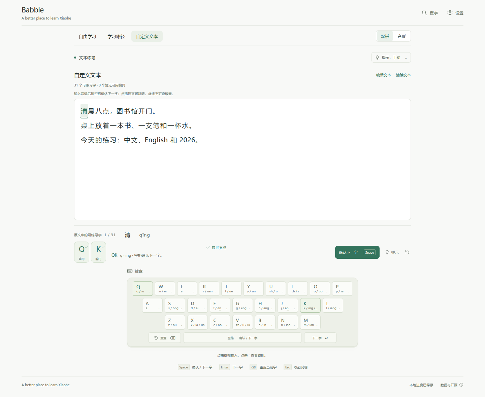
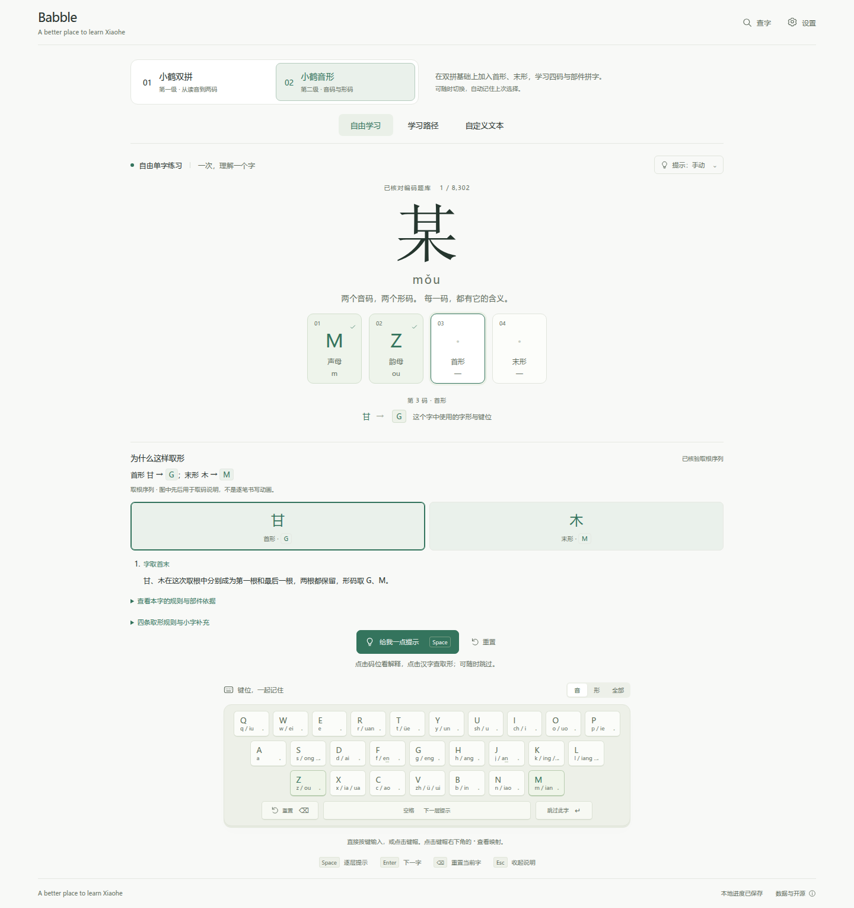

# Babble

**A better place to learn Xiaohe.**

Learn Xiaohe Shuangpin and Xiaohe Yinxing through clear feedback, guided practice, and text you actually want to type. Free to use, with no account required.

[Try Babble](https://yohanemashiro.github.io/Babble/) · [简体中文](README.md) · [Run locally](docs/development.md) · [Data and attribution](docs/data-sources.md)



## Start with sounds. Add shapes when you are ready.

| | Xiaohe Shuangpin · 小鹤双拼 | Xiaohe Yinxing · 小鹤音形 |
| --- | --- | --- |
| Learn | Initials, finals, and two-key syllables | Sound keys, shape keys, and four-key codes |
| Practice | Build a comfortable rhythm with two keys per character | Connect a character's pronunciation and shape |
| Start here | Selected on your first visit | Switch to it whenever you like |

Babble remembers your last selected level in the current browser. Lessons are open to explore, and each level keeps its own learning goals.

## Practice with your own words

Paste a passage or choose a UTF-8 `.txt` file, up to 20,000 characters. Read the continuous original text while you type; punctuation, line breaks, English, and numbers stay in place. Click a character to jump to that occurrence, then press **Space** to confirm and move to the next one.

Optional **g2pW contextual pronunciation** helps select the reading of polyphonic characters. The model loads when you click Upload TXT or explicitly enable automatic pronunciation for pasted text. Its first download is approximately **175.5 MB**; the bundled sample already has prepared readings and needs no model download. You can change a reading for any individual occurrence, or continue with manual selection.

## Help at each keystroke

- **Immediate feedback:** see which key is correct and where to try again.
- **On-screen keyboard:** connect sounds and shapes to their keys.
- **Guided lessons:** focus on one part of the code before practicing the whole character.
- **Character lookup:** explore available readings, codes, and supported shape explanations.
- **Local progress:** return to your lessons and see which targets you have practiced independently.
- **Your code tables:** import supported local character-code tables for additional practice.



## A few minutes to begin

1. Start in **小鹤双拼**, or choose **小鹤音形** if you already know the sound layout.
2. Open **学习路径** for guided practice, or **自定义文本** to use a passage of your own.
3. Type with the keyboard and follow the feedback. In text practice, press Space to move on; in free practice and lessons, Space reveals a hint.

The application interface is in Chinese. This English README introduces its features and controls.

## Your text stays with you

Files are read and pronunciation is computed in your browser. Your passages are not sent to an inference service. Babble has no account system, analytics, or cloud sync.

Progress and preferences are saved in the current browser when storage is available. Your own practice text, reading choices, and position are kept only for the current page session and are cleared on refresh. Imported code tables are also session-only unless you explicitly choose to save them locally.

## Run locally

With Node.js 22.12 or later:

```bash
git clone https://github.com/YohaneMashiro/Babble.git
cd Babble
npm ci
npm run dev
```

Open the local address shown in the terminal. See [local setup and development](docs/development.md) for model preparation and production builds.

## Contribute

Suggestions, reading corrections, reproducible bug reports, and improvements to explanations are welcome through [Issues](https://github.com/YohaneMashiro/Babble/issues) and [pull requests](https://github.com/YohaneMashiro/Babble/pulls). For dictionary corrections, please include a source and a short example of the intended reading or code.

Babble is an independent learning project, not an official Xiaohe product. Character coverage and available shape explanations vary; entries without a supported practice code remain available to inspect when data exists.

## License and acknowledgments

The combined distribution follows [AGPL-3.0](LICENSE). Babble's original code is also available under [MIT](LICENSE-CODE). Dictionary data, fonts, models, and bundled text retain their own terms and attribution; see [data sources](docs/data-sources.md) and [model attribution](docs/g2pw-model-build.md).

Thank you to Xiaohe and the open-source dictionary, font, and pronunciation projects that make this learning tool possible.
