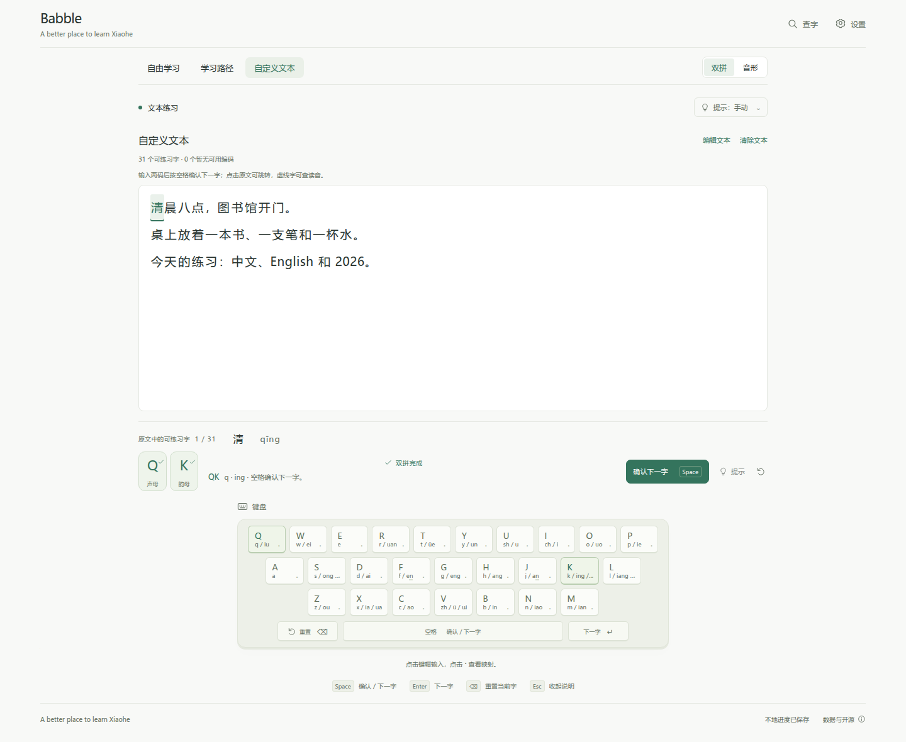
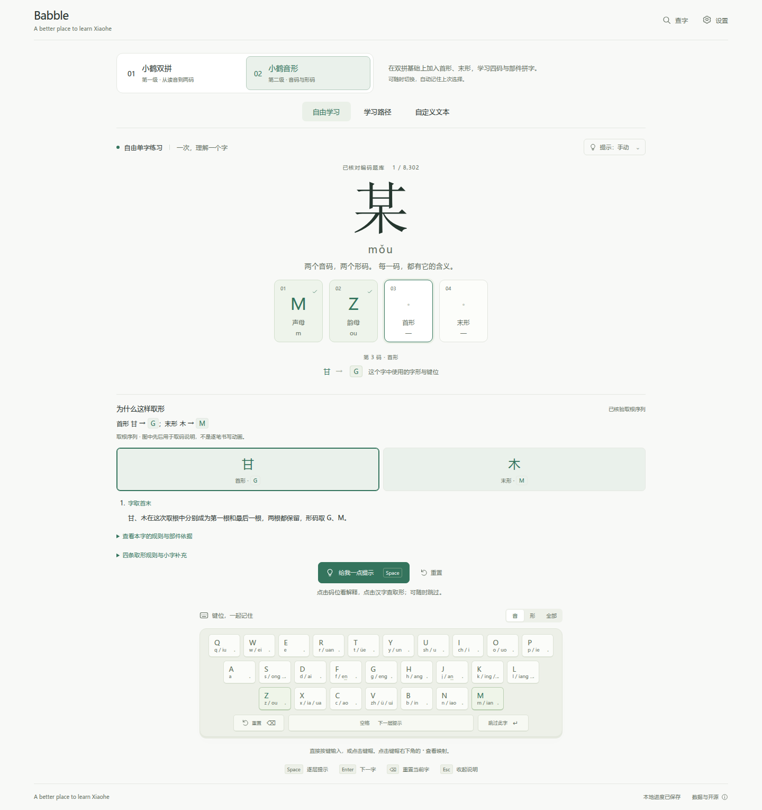

# Babble

**A better place to learn Xiaohe.**

从小鹤双拼到小鹤音形，在熟悉的文字里练出输入的节奏。即时反馈、键位提示和逐字解释，陪你从第一组声韵开始。免费使用，无需注册。

[在线使用](https://yohanemashiro.github.io/Babble/) · [English](README.en.md) · [本地使用](docs/development.md) · [数据与致谢](docs/data-sources.md)



## 先学双拼，再学音形

| | 小鹤双拼 | 小鹤音形 |
| --- | --- | --- |
| 学什么 | 声母、韵母与两码输入 | 声音、字形与四码输入 |
| 怎么练 | 熟悉声韵键位，逐步形成输入节奏 | 理解首末形，把读音与取形连起来 |
| 从哪开始 | 首次打开默认进入 | 掌握双拼后随时切换 |

Babble 会记住你上次选择的级别。课程可以自由进入，两级分别记录学习目标，按自己的节奏往前走。

## 练自己想打的文字

粘贴一段文章、笔记或对话，也可以上传 UTF-8 `.txt` 文件，最多 **20,000 个字符**。连续原文保留标点、换行、英文与数字；当前字在文中突出显示，点击任意可练习字即可跳转。

输入编码后，按 **空格** 确认并进入下一字。

可选的 **g2pW 自动注音**会结合上下文选择多音字读音。点击“上传 TXT”或主动启用时才加载，首次约下载 **175.5 MB**；内置示例已有预处理读音，无需下载模型即可练习。每一处读音都能单独修改，也可以直接使用手动选音。

## 每一码都有回应

- **即时反馈**：看见已经输入正确的部分，知道下一步该按哪里。
- **键盘提示**：把声韵、字根与实际键位对应起来。
- **循序课程**：先练当前目标，再逐步组合成完整编码。
- **查字与取形**：查看已有读音、编码和有资料支持的取形解释。
- **本地学习记录**：继续上次课程，了解哪些目标已经独立练过。
- **自己的字库**：导入支持的本机单字码表，补充想练习的内容。



## 几分钟就能开始

1. 先选“小鹤双拼”；已经熟悉双拼，也可以直接进入“小鹤音形”。
2. 打开“学习路径”跟随课程，或用“自定义文本”练自己熟悉的内容。
3. 跟着键盘与逐字反馈输入。在文本练习中，空格确认下一字；在自由练习和课程中，空格逐层显示提示。

网站默认使用中文，英文 README 提供功能与使用方式介绍。

## 文字留在你的浏览器里

文件读取与自动注音都在本机浏览器完成，练习原文不会发送到远程推理服务。Babble 无需账户，没有行为分析或云端同步。

学习记录和偏好保存在当前浏览器。自己的练习文章、逐处读音选择与文章位置仅在本次页面内保留，刷新后清除。导入的字库默认也只在本次使用，只有明确选择保存时才写入本地。

## 本地使用

安装 Node.js 22.12 或更新版本后：

```bash
git clone https://github.com/YohaneMashiro/Babble.git
cd Babble
npm ci
npm run dev
```

打开终端显示的本地地址。模型准备、完整构建与部署见[开发文档](docs/development.md)。

## 一起改进

欢迎通过 [Issues](https://github.com/YohaneMashiro/Babble/issues) 或 [Pull Requests](https://github.com/YohaneMashiro/Babble/pulls) 提出建议、反馈读音、补充取形解释，或报告能够复现的问题。涉及字库更正时，请附上来源和使用语境。

Babble 是独立学习项目，非小鹤官方产品。不同汉字的编码与解释资料覆盖程度不同，缺少可靠训练编码的字会明确提示；有读音资料时仍可查询。

## 许可与致谢

组合发行遵循 [AGPL-3.0](LICENSE)，Babble 原创代码另保留 [MIT 授权](LICENSE-CODE)。字库、字体、模型与内置文本分别适用其来源条款，详见[数据来源](docs/data-sources.md)与[模型署名](docs/g2pw-model-build.md)。

感谢小鹤，以及为字库、字形与中文注音提供基础的开源项目。
