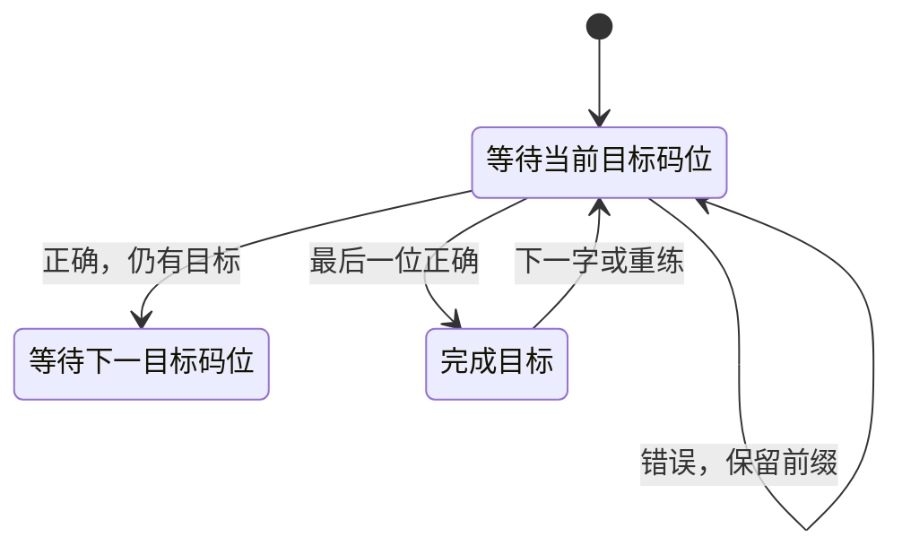

# Babble 架构

Babble: A better place to learn Xiaohe。2026-10-26 当前阶段已接入自定义文本，保留 React / TypeScript / Vite 单页结构，没有后端、路由、账户或远程逐字查询。本次扩库为旧记录增加独立的拆字与笔顺来源链，默认练习文章仍单独记录来源。

## 模块边界

| 模块 | 职责 |
| --- | --- |
| `src/app/App.tsx` | 组合自由 / 课程 / 文本工作状态、目标码位、切字、讲解和浮层，结束尝试并更新相应位置。 |
| `components/CodeSlots`、`VirtualKeyboard` | 区分已提供与需练码位，显示逐位状态、鼠标 / 物理键输入、上下文含义及按需映射。 |
| `components/CharacterInspector`、`LearningPath` | 本地查字与显式读音选择；自由进入课程、程度推荐、进度与继续练习入口。 |
| `components/TextEditor`、`TextTrainer` | 默认文本预填、粘贴 / UTF-8 TXT 本地导入与限制反馈、原文分页、逐次定位、缺失字查询及本处读音选择。 |
| `data/practice-text.ts`、根目录 `HY.txt` | 导入用户指定的默认练习文章《花园中》，与编码字典独立。 |
| `domain/encoding.ts`、`training.ts` | 四码解释、一致性校验与支持目标码位的纯 reducer；UI 不猜编码。 |
| `domain/text.ts` | Unicode 码点分词、来源选项、文本计数、400 目标分页及 token / target / page 定位。 |
| `domain/lessons.ts`、`data/lessons.ts` | 课程类型、可用字校验、来源排序和 15 个课程定义；先修项只作推荐。 |
| `domain/progress.ts` | 尝试记录、同范围目标标识、独立连续与曾掌握判断、快照校验。 |
| `state/learning-storage.ts`、`hooks/useLearningProgress.ts` | IndexedDB 事务读写、写入排队、已提交状态与内存降级。 |
| `domain/sound.ts`、`dictionary.ts` | 对已有读音使用已核验声韵表；零声母 / ü 处理、本地字符索引与搜索。 |
| `data/library.ts`、`data/generated/` | 原全码 / trace 与现代读音精确匹配，构造已有训练条目及部分字根关联。 |
| `scripts/import-*.py`、`tools/libre-flypy-audit/`、`tools/shape-expansion/` | 可复现导入和核验，独立于正常网页构建。 |
| `scripts/package-source.mjs` | 构建后复制许可通知与完整对应源码供下载。 |

## 字符与课程数据

`CharacterEntry` 保留读音组成、首末根、原全码、备选与多来源。`DataProvenance` 包含作者、许可、版本、摘要、获取日期、修改和再分发状态。期望键来自解释字段，`fullCode` 用于交叉校验。现有 8,143 字可训练、44,348 字可查现代读音；缺取形不造码，多音由用户明确选择。

`Lesson` 的 id、标题、分组、entries、focus、讲解与推荐均由数据定义。`resolveLessonEntries` 只解析已有核验条目，定义中有缺失字会报错；课程规模不写入训练引擎。认识小鹤与综合课练全码，声母 / 韵母 / 双拼 / 首形 / 末形等课程只练对应位置。其他码位作为上下文提供，状态为 revealed，不能当作已正确输入。

程度选择默认「会小鹤双拼」，只影响推荐起点；所有课程始终可进入，没有解锁校验。示例默认折叠，主动展开后按协助处理。

## 两条取形来源链

旧 `shape-traces.json` 保持原字节、原来源及旧 CC0 发布代码的引用。`shape-expansion.json` 仅保存额外代码，来自锁定的根定义、Yi Bai IDS、OverflowCat IDS 修订、KFCD 拆字、Unicode 等价映射与 TJYSunset 明示笔顺。六类笔画归类、递归边界和参考验证均在独立 Python 工具执行，正常构建不运行该工具，也不需要研究参照。

扩展候选的首末路径共用同一顶层拆法，再各自沿对应边界递归；明确笔顺可以提供首末笔。参考文件仅用于排除编码或根不符的候选，不能构造输出字段。仅为比较去掉根标签末尾的拉丁读音注记，不替换汉字根名。外部参照的原文件不进入项目或源码包。

`library.ts` 按字组合旧、新 trace，再逐读音匹配；旧条目优先去重，保留原有 7,113 个选项和来源。每个新条目的 `sources` 只列其实际输入链，根定义、原 IDS 与修订分别署名；不能把生成的扩展编码描述成原 CC0 发布记录。全库 8,143 字 / 8,806 选项，读音查询仍为 44,348 字。

`data/shape-expansion.lock.json` 锁定工具、输入及生成物，输入的上游摘要另见 `shape-expansion-inputs.lock.json`。更新派生输出锁之前仍强制核对上游声明的每份输入；不能用 `--update-lock` 为被修改而仍声称原版本的数据补盖章。`scripts/audit-coverage.mjs` 使用本机 Vite SSR 加载实际运行库，统计文本覆盖与缺字，没有 HTTP 服务或原文上传。

## 自定义文本与位置模型

根目录 `HY.txt` 由用户提供的 `HY.docx` 按正文段落转为 UTF-8 文本，`data/practice-text.ts` 使用 Vite `?raw` 导入，并通过 `DEFAULT_PRACTICE_TEXT` 提供标题与内容。它随应用分发，只作为题目来源，不参与编码推断。初始页面仍是自由学习；首次打开自定义文本编辑器才预填《花园中》。已有文本会话编辑时保留其自身内容，清除文本后本次页面继续使用空白编辑器，可主动点击填回默认文章。

`TextEditor` 直接接受粘贴，也可从 file input 读取 `.txt`。读取前校验扩展名及 80,003 字节上限（20,000 个最多四字节的 UTF-8 码点加 BOM），读取后以严格 UTF-8 解码并再次检查 20,000 码点上限；拒绝时保留编辑框原文，不截断。读取异步结果通过请求编号约束，新文件选择或手工编辑会使旧读取结果失效，卸载后不再应用结果。文件只在浏览器内读取，无上传接口。

`analyzeText` 先按 Unicode 码点计数，超过 20,000 时返回拒绝结果，不截断、不查询或补造编码。2,000 个汉字只作长度建议。有效文本的 `TextDocument` 保留每个原始码点及索引；Han 字按现有索引分为 trainable / unavailable，其余作为 literal。相同汉字查询可复用索引结果，每次出现仍是独立 token。

`targets` 存原文中有可靠编码的 token 索引，重复字不会去重；训练位置是 target 索引，原文分页位置独立保存。页范围采用左闭右开，每页最多 400 个可训练目标；所有页拼接能精确还原原文，保留标点、英文、数字、换行、未知字和末尾内容。只翻页不加载题目；点击可练习字才跳到该次出现位置，并同步到其原文页。缺少取形的汉字不进入目标序列，界面明确标记并允许查询。

`readingOptions` 从来源条目与读音记录创建选项，以读音与完整编码标识已有条目。多选项时 `getTextEntry` 不提供默认编码，必须按本处位置明确选择；同字的另一次出现不继承选择。仅读音或非法选项不会回退到其他可用编码，训练暂停，可明确跳过。

普通读音选择不展示编码，不算协助。同一读音存在不同编码时，选项标记 `disclosesCode`，界面需展示编码供区分；该目标因此记录协助。自定义文本仍向同一 reducer 加载四个目标位，不另建验证、反馈或提示引擎。

## 训练状态与尝试边界

`TrainingState.positions` 是升序且不重复的原四码位置。accepted 只包含目标位的正确前缀，typed 保留所有有效字母键，包括错键；error.position 始终是原四码位置。`currentCodePosition` 定位下一目标，`trainingCode` 返回本次目标编码。默认 positions 为四位，保持自由学习行为。

Space 逐层提示到 4；正确后重置当前可视提示，但 hintLevelUsed 保留本次峰值。停顿 6.5 秒可自动递进，最多到内容层 2；错误、失焦、隐藏页面或浮层时暂停。提示及显式解释动作设置 assisted；已提供的非目标位不因此计为协助。完成后的提示 / 解释不会改写已完成尝试。

完成在输入处理器内只记录一次。切字、换课、切模式、重置或结束本轮会结束当前未完成尝试；不把它当作正确完成。完成一轮只表示走过课程序列或文本，不等于掌握全部目标。结束弹窗可以再练或更换内容；未完成末题结束后返回时从该字重新输入。

打开文本编辑器暂停训练，取消时保留当前尝试；提交新文本则结束原未完成尝试并创建新的文章与读音选择集合。切到其他模式结束当前未完成尝试，返回文本模式保留文章位置并重新加载当前目标。清除文本移除当前文章，打开空白编辑器。

## 进度语义

`AttemptRecord` 包含字、完整编码、实际 typed、目标编码、positions、完成 / 正确、首个错位、协助与提示峰值、时间和可选 lessonId。`correct` 表示完成且没有错键，独立正确还要求未用协助 / 提示；纠正后完成仍保留错误事实。

进度 key 为「char + fullCode + positions」。自由学习、课程和自定义文本只在这三项完全相同的范围内共享 seen、attempted 和 mastered；首形练习不能累计成完整四码掌握。

同一目标的相邻尝试连续两次独立正确，达到曾掌握条件。错误、提示 / 解释协助、跳过或重置的已开始未完成尝试打断当前连续；bestIndependentStreak 保留历史最高值，因此达到过的掌握不会按日期过期，也不会被后续一次错误抹除。看过指目标已呈现，练过指已有字母输入的尝试；仅查看提示不冒充已输入。

## 本地持久化与恢复

IndexedDB 数据库 `babble-learning-v1` 使用 state 存快照、attempts 存原始尝试。快照包含经验起点、目标累计、课程上次位置和上次课程 id；一次记录的快照与原始尝试在同一事务提交。

hook 先完成读取 / 校验，再允许记录；更新立即反映到内存，持久化写入按序排队。页脚明确区分读取 / 保存中、事务已经提交和仅内存保存，不在请求刚发出时宣称已落盘。原 localStorage 自动提示设置继续保留。

读取失败、版本 / 内容校验失败、阻塞或写入失败时降级为本次内存记录，不自动删除或覆盖无法安全读取的原数据。刷新后「继续练习」可恢复课程题目，未完成按键前缀不恢复；关闭页面前应等待已保存状态。没有云同步、analytics 或每日到期任务。

用户粘贴 / 上传的源文本、逐次读音选择、文章位置与页码仅在 `App` 内存会话中保留，不写入 IndexedDB 或 localStorage；刷新会清除自有文章与会话。内置《花园中》属于构建内的默认内容，刷新后首次打开编辑器仍可预填，不是对上次文章或位置的持久化恢复。文本训练产生的常规单字尝试仍沿用 `AttemptRecord` 持久化，记录字、编码和输入结果，不附原文、文章位置或新的文本来源标识。

## 输入、分发与下一阶段

`keydown → 焦点 / 修饰键过滤 → reducer → 内存查表 → render`。记录异步写入本机，不增加网络逐字请求。原生 dialog 管理焦点；查看 Inspector、设置、课程选择、文本编辑器与键位浮层时暂停实体训练，搜索框与文本编辑不污染编码输入。文本读音尚未明确或所选读音缺少可靠四码时，不接受训练字母键，仍可使用 Enter 跳过。

源码归档、工具、锁定输入与原许可通知继续随构建提供，组合分发保留 AGPL 义务，原创 MIT 授权仍保留。归档白名单包含默认练习所需的根目录 `HY.txt` 和独立来源通知，不包含原始 `HY.docx`。文章未附作者或独立许可证声明，不将其混同于代码或字典授权。下一阶段打磨初版交互与教学，再按实际仓库配置 GitHub Pages；当前没有部署站点。
