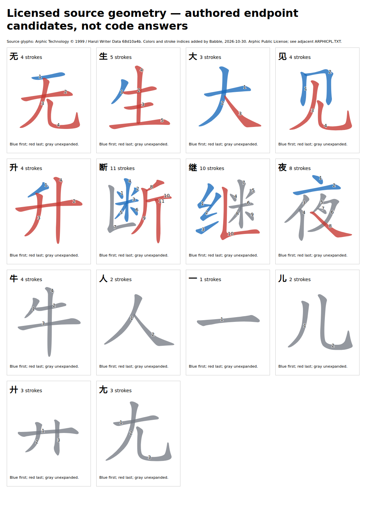

# 常用缺字：从有序字形到可审查端点

日期：2026-10-30（Asia/Dubai）。这是研究结论，正式应用仍为8,302字四码／60,891字输入并集。本轮补足上一轮缺少的笔画几何来源，未修改生产数据、旧锁或课程。

## 新找到的可复现来源

采用[Hanzi Writer Data固定提交](https://github.com/chanind/hanzi-writer-data/tree/68d10a4b21150cae5e1ebbd223eed289cf32d90c)的14份单字JSON。它有按笔顺排列的轮廓和中线；许可是[Arphic Public License](https://github.com/chanind/hanzi-writer-data/blob/68d10a4b21150cae5e1ebbd223eed289cf32d90c/ARPHICPL.TXT)，与Hanzi Writer程序的MIT分别处理。不能把程序开源直接当成字形MIT。

另取[Make Me a Hanzi固定提交](https://github.com/skishore/makemeahanzi/tree/bddc96d41bef78427ed0e034e9f7e31d71fd1b92)的字典与笔画部件路径。其[来源与许可说明](https://github.com/skishore/makemeahanzi/blob/bddc96d41bef78427ed0e034e9f7e31d71fd1b92/COPYING)区分字典LGPL-3.0-or-later和图形Arphic许可。原JSON、完整字典和源通知留在项目外；选出的14条字典记录与原行逐字节相符。

这补上了升、断、继、夜没有固定有序笔画的缺口，也让“同一种笔画字符串”与“同一个几何部件”可以分别检查。Chai的GPL核心仍可用作后续规则工具，但原远程字形API的独立分发许可问题没有因核心开源而自动解决。

## 逐字研究结果

下面编号为一基笔顺；程序内部使用零基索引。蓝色为首端范围，红色为末端，灰色未展开。**本轮只确认有限端点，不把图片称为完整取根教学。**

| 字 | 首端 | 末端 | 资格与限制 |
| --- | --- | --- | --- |
| 无 | 第1画：横 | 第2–4画：尤省点形（尢） | 编码与根标签都一致；普通根Y与分析尢本字的U／V捷径需要语境模型，继续保留复核状态 |
| 生 | 第1画：撇 | 第2–5画：龶 | 明确保留“丰变形”的部件身份；不能仅凭前四笔与牛同类就认作牛 |
| 大 | 第1、2画：𠂇 | 第3画：捺 | 采用已有部件定义和实际接触／相交关系；此字已经可用，不重复计算净新增 |
| 见 | 第1、2画：冂 | 第3、4画：见下 | 为见下建立稳定命名ID；不能把字典结构标签儿直接改成教学根名。只接纳核对一致的jiàn码对，xiàn候选不通过 |
| 升 | 第1画：撇 | 第2–4画：廾 | 有序来源可直接定位，不再把IDS排列冒充笔顺 |
| 断 | 第1–6画：米 | 第8–11画：斤 | 第7画保留未展开；有序路径支持两端 |
| 继 | 第1–3画：纟 | 第10画：折 | 第4–9画保留未展开；围住米的折实际写在后面，IDS包围节点次序不足以决定末形 |
| 夜 | 第1、2画：亠 | 第8画：捺 | 第3–7画保留未展开；不能随意忽略插入笔画或把结构子项当作末根 |

图形修改与来源见[独立通知](research-assets/common-character-geometry/NOTICE.md)，完整[Arphic条款](research-assets/common-character-geometry/ARPHICPL.TXT)与源摘要一并保留。颜色和编号由Babble于2026-10-30添加，原轮廓来自固定来源，没有复制官方教程图。

首末键来自现有AGPL根事实、既有六类笔画及公开的[部件定义](https://flypy.cc/help/zg.md)和[通用规则](https://flypy.cc/help/gz.md)。根名、键位、笔画范围和规则应用分别记录。原`roots.rs`同时承担“部件作为根”的键和“某字继续拆分”的首末捷径，直接把同一码点全局覆盖成一个键会丢失语境；无的尢就是明确反例。

## 候选先生成，再比较

外部`build-candidates.mjs`先冻结8字／11个现代读音码对和各输入摘要，SHA256为`a7f9291d4774738b811055ebc35b8d465f88c0e948322eeaa5b858a7ab76a317`；独立`compare-candidates.mjs`随后才打开固定参照。10个码对一致，8字均至少有一码一致；见的xiàn不一致，没有修码或随整字升格。

字面根符号5字一致。大／夜的捺、继的折使用不同历史符号，但**上一阶段已经固定**的六类笔画规则将其归为同一类；只对已标为单笔的对象应用这套旧规则，得到8字语义根类别一致。没有把儿等非笔画根折叠成见下。原候选与其摘要保持不变，这一项另记为比较后的分析投影。

该实验不是盲测：此前研究已经见过部分失败结果。因此结果证明的是有限来源链、端点选择与固定参照的一致性，不是通用自动取形准确率。独立checker检查了源摘要、全部笔画分区、现代读音、实际音码程序和对照结果，并目视复核研究图。

工程上先保留无的语境复核，只采纳其余7字中的8个通过码对；大已可用，**实际补6个缺字：升、断、见、生、继、夜**。与新的拼字研究集合合并后，可把HY目前仍缺的14次补齐，达到1,840／1,840个汉字出现次数；这不是所有Unicode字或任意读音全部可练的声明。

## 交给工程师的具体要求

1. 新增有稳定ID、名称、可选单字形符、键位、源定位和所选笔画范围的根引用。见下不能被塞成另一个看似相同的Unicode字；尢的普通部件身份不能被端点捷径全局覆盖。
2. 策划字按读音／全码对筛选；保留未通过读音的查询身份，不能要求一个字的全部现代读音同时通过后才收录，也不能因一个音通过而提升其余音。
3. 两端可显示来源、范围和灰色未展开区域；未审完的中间序列不生成教学卡。旧字条目、课程和26键定义保持不变。
4. Arphic矢量、LGPL字典路径、AGPL根事实和原创程序分别存放、保留原条款及修改说明，不统一标为MIT。先完成各资料层发行审查再接入。

完整可复跑原件位于项目外`/root/.cache/babble-coverage-next/common/`，含来源下载清单、生成器、原始候选、比较、语义分析、图形渲染器与NOTICE；独立审计位于相邻`checker/common-finite-independent-audit.json`。当前页面与字库尚未采用本轮候选。
